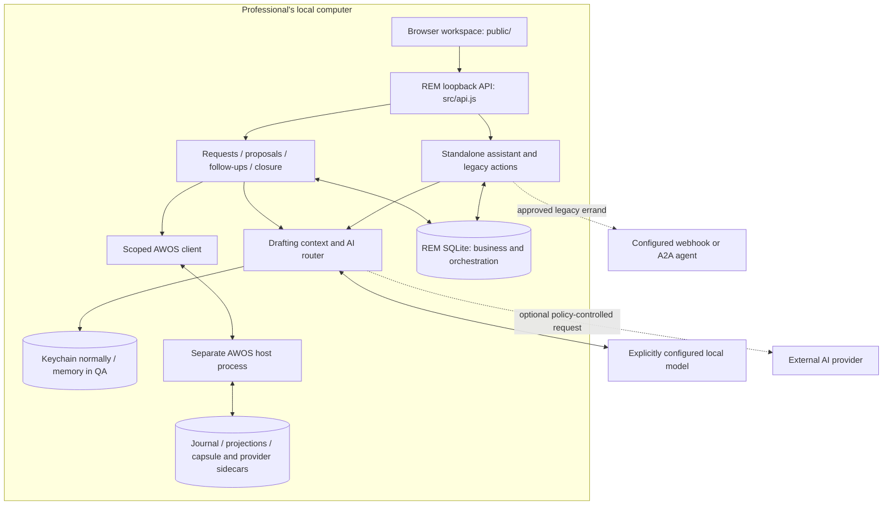

# Layers, execution modes, and authority

## 1. Current topology

REM has two existing execution paths. They share a browser interface but have different state owners. Converging them is a product gate, not a cosmetic rename.

### Standalone local application

`src/server.js` opens REM's database and serves `public/` and `src/api.js` over loopback. `src/db.js` holds contacts, tasks, chat, proposals, pasted inbox entries, errands, audit, and settings. The assistant proposes domain actions and the owner reviews them. `src/actions.js` applies approved local changes.

Message approval saves a draft and produces a manual opening link for Mail or WhatsApp. The recipient still receives nothing from that approval. However, the legacy `encargar` action may dispatch an approved request through `src/external-agents.js` to a configured webhook/A2A service. That route is outside AWOS C6 and must not be described as having the same governed effect guarantees.

### Experimental governed application

`PYME1_AWOS_EXPERIMENTAL=1` activates `src/awos-guard.js`. It requires distinct marked temporary directories, memory secrets, and an explicit port other than the installed default 4317. It rejects real connector environment variables.

`src/awos-process.js` starts the included `runtime/awos/pymes/tests/fixtures/pyme1-harness.ts` in a child process using the runtime's existing `tsx` loader. A generated process token stays in memory. The REM client has a closed list of operations and validates ownership and response shapes. The host uses synthetic contacts and recipients. REM has no execute or reconcile operation in this mode.

The fixture is intentionally a development host, not a production daemon renamed as a fixture. The public source includes its dependencies so integration tests can be reproduced.

## 2. Responsibility map

| Layer | Main source | Owns / must not own |
|---|---|---|
| Browser | `public/app.js`, panel and module renderers | Views, explicit input, loading/error states; no inferred approval |
| REM API | `src/api.js` | Session/Host/Origin checks, parsing, bounded routing |
| AI | `src/agent.js`, `draft-context.js`, `draft-dates.js`, `ai/router.js` | Proposed text/classification; no delivery facts or independent authority |
| Request intake | `src/awos-intakes.js` | Idempotent capture and identity/provenance receipts; AWOS contact link |
| Proposal orchestration | `src/awos-flow.js`, `proposal-templates.js` | Local operation/version mapping and decision intent; AWOS owns actual review |
| Follow-ups | `src/awos-followups.js` | Durable local schedule and preparation through the existing flow; no sender |
| Response / closure | `src/awos-business.js` | Local intent/receipt; AWOS owns opportunity and CRM changes |
| Module library | `src/rem-modules.js`, `public/module-*` | Availability/configuration through the existing runtime registry |
| Runtime composition | `runtime/awos/pymes/src/runtime-source.ts` | CRM, review queue, task/effect composition, journal/recovery integration |
| Persistence | REM DB plus runtime SQLite/sidecars | Distinct authority; no second local authoritative CRM cache |
| Copies | `backups.js`, `awos-copy-service.js`, `awos-archive.js` | Explicit inventory, coordination, verification, separate restore environment |

## 3. Runtime kernel responsibilities

The AWOS source retains the existing C1–C12 architecture. These concepts describe the runtime, not a claim that every legacy REM action already passes through it.

| Kernel area | Responsibility |
|---|---|
| C1 SessionContract | Bounded session identity and applicable authority |
| C2 ResourceRegistry | Typed resource identity and access contracts |
| C3 Leases | Time-bounded coordination and ownership |
| C4 Budgets | Accountable resource/cost limits |
| C5 Observation | Evidence acquisition separated from action execution |
| C6 EffectTransaction | Durable claims/attempts and external effect state |
| C7 Reconciliation | Resolve uncertain outcomes from evidence without blind re-dispatch |
| C8 CompositionPolicy | Composition constraints and permitted combinations |
| C9 InformationFlow | Boundaries on information movement |
| C10 Supervisor | Supervised execution lifecycle |
| C11 GovernedActionRunner | Run authorized actions through shared contracts |
| C12 CrashRecovery | Recovery from interruption using durable state and evidence |

Consult the corresponding `runtime/awos/packages/` source and tests for exact types and transitions. A review decision does not bypass dispatch preconditions, leases, effect claims, or the runner.

## 4. Versioning and uncertainty

A business operation has an identity and versions. A review binds the exact recipient/content/version. A changed draft requires another review. A durable command identity makes repeating an admitted request safe according to its contract; a new UUID is not a generic recovery strategy.

C6 `UNKNOWN` means an external result is unresolved. It cannot be rewritten as failed or cancelled to justify sending again. Claims and evidence remain available for the existing observation/reconciliation path. A module-configuration request with an unconfirmed HTTP response is different: its frozen UI request is retried with the same command identity, while the registry owns the durable receipt.

Pausing a module denies new admission. It preserves history and does not revoke work already admitted. If an action is shared with another active module, that active module may still expose it within its normal business authorization.

## 5. AI context boundary

The drafter receives the customer name, channel, literal request, and only explicitly requested extra context. Date equivalences are scoped to temporal expressions in that request. Relative deadlines should remain relative. Unexpected numbers/dates generate visible review warnings; drafts are retained rather than silently discarded.

Classification and task extraction have their own context needs. Neither a large model nor a deterministic language signal is an authorization boundary. Spanish evaluation fixtures remain unchanged when the English presentation is introduced. English assistant competence needs separate measurement.

## 6. Intended convergence

The destination is one coherent workspace and authority model: intake → identity → preparation → review → governed execution where enabled → observation → CRM follow-up → closure. Moving the legacy application onto that path requires a migration preview, compatibility, verified backups, rollback, and a separate release decision.

Document checklists, appointments, provider connectors, production sending, and delegated customer agents are unfinished. Their components must reuse existing contracts instead of creating hidden alternate effect paths.
