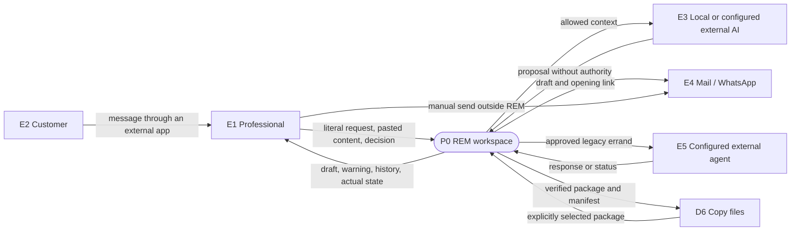
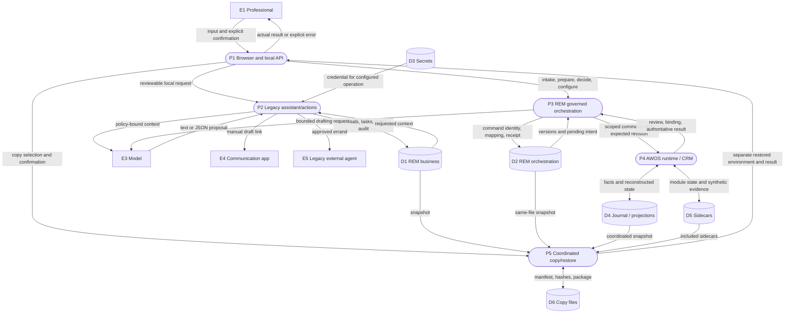
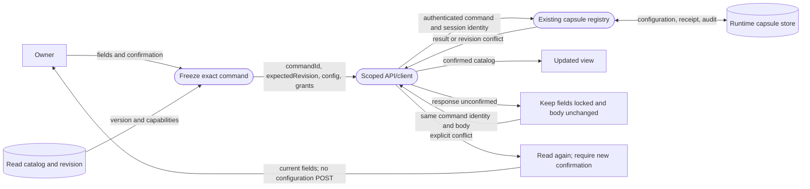
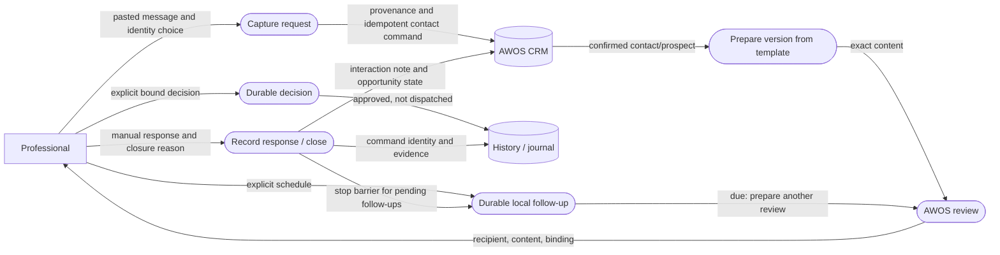

# Data-flow diagrams

These diagrams describe data movement and trust boundaries. They are not exhaustive call traces or proof that a future feature exists. Solid arrows describe current paths; the final diagram is explicitly a target.

## Dictionary

| ID | Entity/store | Meaning |
|---|---|---|
| E1 | Professional | Requests, pasted messages, review, explicit decisions |
| E2 | Customer | External communications currently entered manually into REM |
| E3 | Model | Authorized prompt context; untrusted proposed text or JSON |
| E4 | Communication app | Manual draft-opening links, not integrated delivery evidence |
| E5 | Legacy external agent | Configured approved errand destination |
| D1 | REM business | Legacy business records in `data/pyme1.db` |
| D2 | REM orchestration | Command/version/receipt tables in the **same file as D1** |
| D3 | Secrets | Keychain normally; memory for synthetic QA |
| D4 | Runtime | `runtime/runtime.db`: journal, projections, CRM, review/effect state |
| D5 | Sidecars | Capsules/configuration and fake-provider evidence |
| D6 | Copy package | Verified manifest and explicit SQLite inventory |

Every incoming document, message, model answer, and connector result is untrusted content. None grants an actor additional permission.

## DFD 0 — current context

Automatic WhatsApp/Telegram/iMessage account ingestion is not represented because it is not the current REM capability. A configured legacy agent is not a completed identity/delegation federation.

## DFD 1 — processes and authority

P3 currently runs under synthetic-host restrictions and does not admit real dispatch. D1 and D2 are logical subdivisions of one SQLite. A restore creates another environment instead of overwriting the installed instance.

## DFD 2 — module configuration and lost response

The browser's pending form buffer lasts for that open dialog/session. Durable registry receipts are separate. Do not equate this UI state with a C6 external effect `UNKNOWN`.

## DFD 3 — request to closure, without real dispatch

A scheduled follow-up is not proof of an earlier delivery. Before enabling real sending, protect the source operation across follow-up preparation, supersession, and closure races.

## Target — governed external effects and customer agents

**Future REM capability, not enabled by this snapshot.**

```mermaid
flowchart LR
  Customer[Verified customer agent / authorized channel] -. identity, message, delegated scope .-> Ingest([Connector / source validation])
  Ingest -. idempotent provenance .-> Plan([Bounded business proposal])
  Plan -. exact action/revision .-> Policy([Policy and applicable authorization])
  Policy -. authorized task .-> Runner([AWOS Governed Runner])
  Runner -. durable C6 claim / attempt .-> Journal[(Journal / evidence)]
  Runner -. external request .-> Provider[Official provider]
  Provider -. verified acceptance .-> Commit([Commit effect])
  Commit -. COMMITTED and evidence .-> Journal
  Runner -. ambiguous or lost result .-> Unknown([UNKNOWN: observe without resending])
  Unknown -. evidence lookup .-> Provider
  Provider -. evidence or unresolved absence .-> Unknown
  Unknown -. reconciled result or retained uncertainty .-> Journal
```

Incoming text cannot authorize an operation. Delegated agent interactions need verified identity, revocation, bounded scope, consent, audit, and human escalation. UNKNOWN cannot be relabeled to obtain another send attempt.
